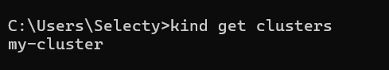
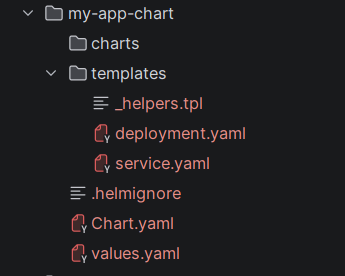
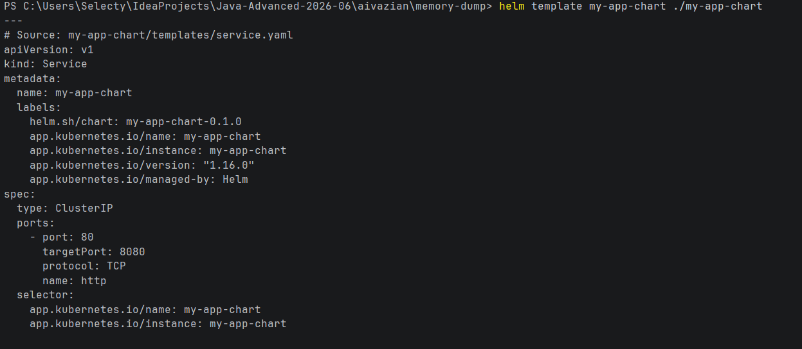
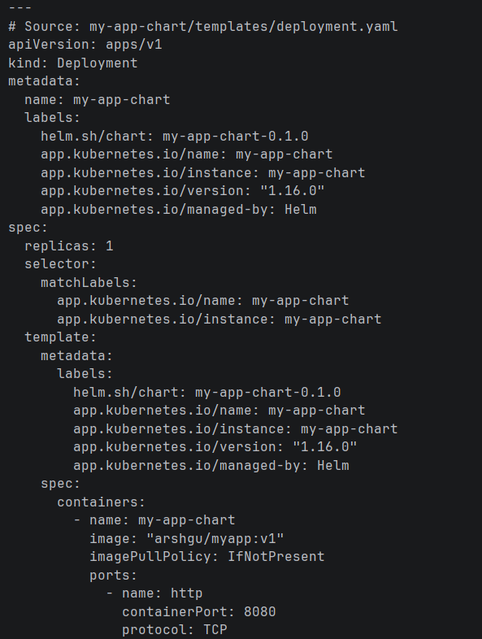
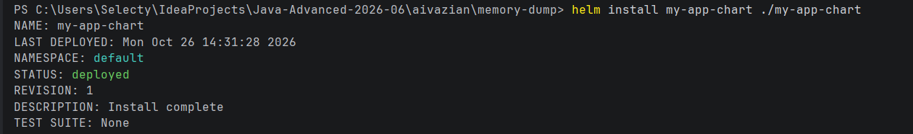
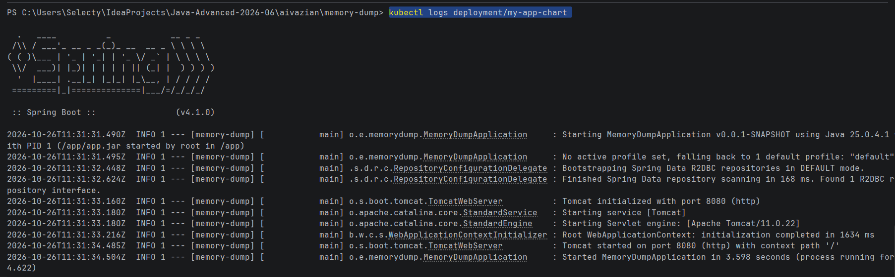
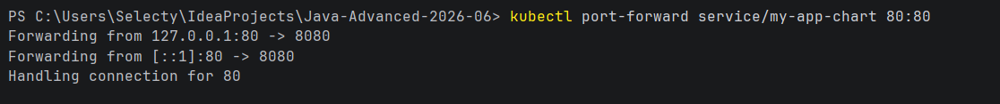
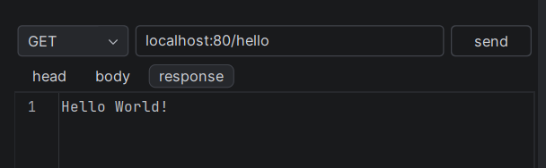

# Домашнее задание: Запуск SpringBoot приложения в Kubernetes с помощью Helm

## Подготовка docker образа
1. Собрать проект
> mvn clean install
2. Собрать docker образ
> docker build -t myapp:v1 .
3. запушить docker образ в registry
> docker push arshgu/myapp:v1

## Деплой приложения в kubernetes с помощью Helm
1. Установить кластер
> kind create cluster

Для проверки вывести список доступных кластеров

2. Генерируем базовый chart и удаляем ненужные template
> helm create my-app-chart

3. Редактируем values.yaml, deployment.yaml, service.yaml
4. Проверка генирации артефактов с помощью helm
   
   

5. Установка приложения
   
6. Проверим что приложение поднялось
   > kubectl logs deployment/my-app-chart
7. Для локального доступа пробрасываем порт 80
   
8. Чтобы достучаться до нового эндпоинта, теперь нужно сделать запрос
   http://localhost:80/hello

