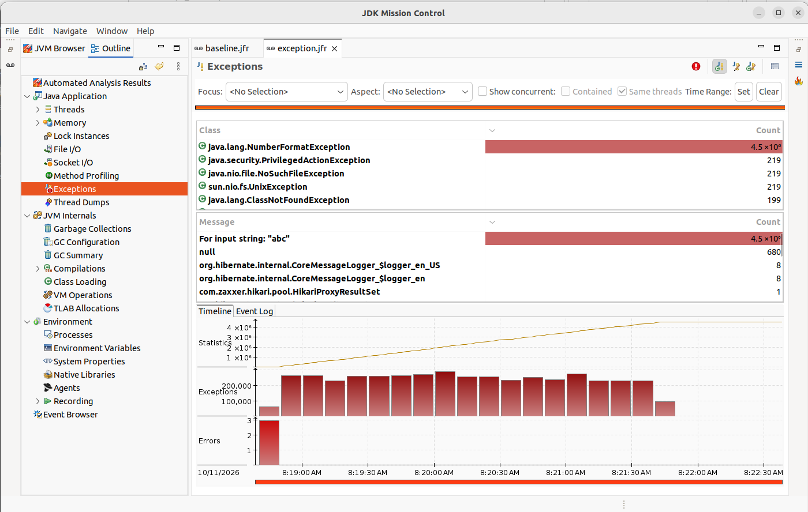
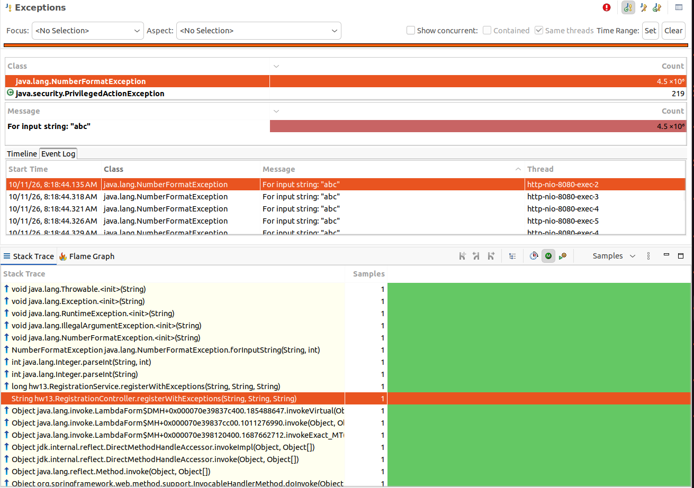
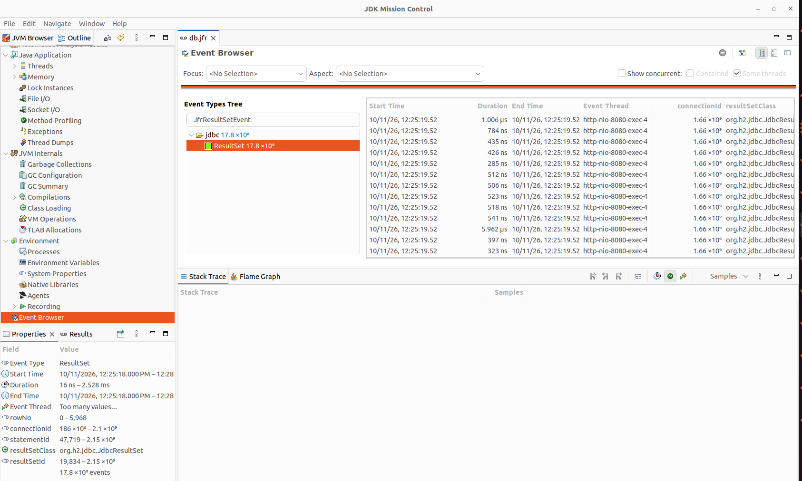
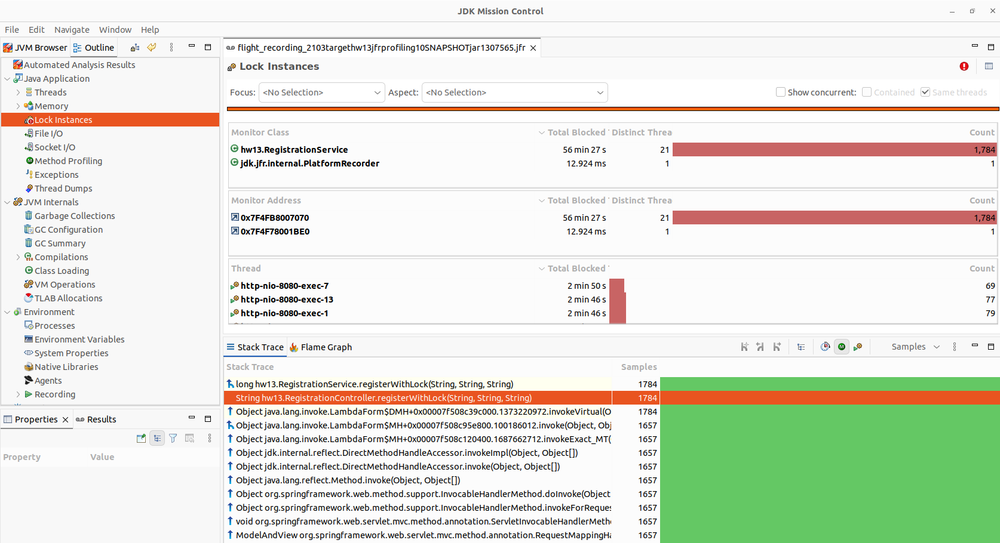
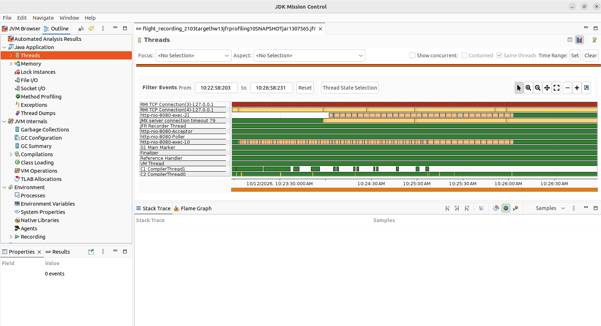

# Профилирование сервиса регистрации

Сервис регистрации пользователей. Кроме обычного POST /register в нем три проблемных
эндпоинта: /register/exception, /register/db, /register/lock. Проблемы ищу через jfr:
гоняю каждый эндпоинт под нагрузкой, пишу запись jfr, сравниваю с чистым
прогоном (обычная регистрация). Для видимости jdbc-событий подключил jfr4jdbc
(url обернут в jdbc:jfr:).

## Как снимал прогоны

поднимаю сервис (java -jar target/hw-13-jfr-profiling-1.0-SNAPSHOT.jar), в JMC
запускаю на нем Start Flight Recording - шаблон Profiling, 4 минуты, Exceptions
переключаю на All. Сразу после старта записи включаю нагрузку: user-registration.jmx,
20 потоков, ramp-up 5 c, Duration 180 c. В плане четыре запроса, на прогон оставляю
включенным один, остальные отключаю. Когда тест отработал, сохраняю jfr summary -
файлы с итогами приложены к разделам.

## Чистый прогон

сначала прогнал обычную регистрацию POST /register, результат в register-summary.txt

## Проблема: исключения

по summary (exception-summary.txt) в чистом прогоне было 1202 события
jdk.JavaExceptionThrow, здесь 4496930. при анализе exception.jfr в JMC на графике
внизу вкладки видна ровная полоса исключений на все время нагрузки, до и после
нагрузки их почти нет. на вкладке Exceptions сверху java.lang.NumberFormatException
(4,5 млн) с сообщением For input string: "abc", это jmeter отправляет кривой возраст

выделил одно событие в Event Log, внизу в панели Stack Trace видно цепочку вызовов:
Integer.parseInt, [RegistrationService.registerWithExceptions](src/main/java/hw13/RegistrationService.java) и контроллер

## Проблема: запросы в бд

по summary (db-summary.txt) чтений строк из базы (JfrResultSetEvent) здесь
17822903 против 109630 в чистом прогоне, при этом самих запросов в сотни раз
меньше: 12077 против 5591064
перед вставкой код выгружает всех пользователей через findAll() и ищет дубль по памяти,
таблица растет с каждой вставкой, и каждый следующий запрос перечитывает все больше строк.
в jmc видно, что все эти события исходят из одной цепочки: org.h2, SessionImpl,
findAll (SimpleJpaRepository) и [RegistrationService.registerWithExtraQueries](src/main/java/hw13/RegistrationService.java)

## Проблема: блокировка

по summary (lock-summary.txt) событий jdk.JavaMonitorEnter здесь 1785 против 51
в чистом прогоне. jmeter за эти же 3 минуты сделал всего 1785 запросов, выходит
по одному блокированию на запрос. [registerWithLock](src/main/java/hw13/RegistrationService.java) у меня synchronized и внутри
еще спит 100 мс, потоки выстраиваются в очередь и ждут, пока другой поток спит

в JMC на странице Lock Instances все эти блокировки у одного монитора,
hw13.RegistrationService

а на вкладке Threads дорожки http-nio-8080-exec во время нагрузки красные -
потоки ждут монитор, до и после нагрузки дорожки зеленые

