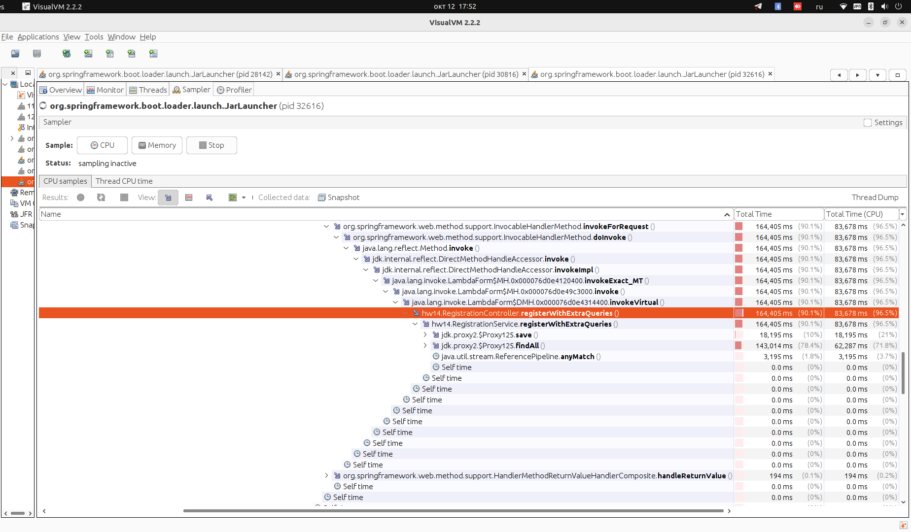
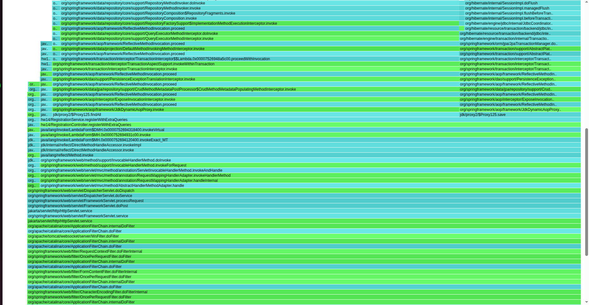

# Профилирование сервиса регистрации в visualvm

Сервис регистрации пользователей из прошлых дз. Для этого задания оставил в нем
одну проблему: лишние запросы в бд - POST /register/db перед вставкой выгружает
всех пользователей через findAll() и ищет дубль по памяти.

## Как снимал

поднимаю сервис (java -jar target/hw-14-visualvm-1.0-SNAPSHOT.jar) и запускаю
в JMeter user-registration.jmx: 20 потоков, 3 минуты, в плане один запрос
POST /register/db. профилировал двумя инструментами: семплером cpu в visualvm
и async-profiler (asprof start -e itimer <pid> на минуту нагрузки, потом
asprof stop -o flamegraph -f flamegraph.html <pid>)

## Проблема: запросы в бд

в visualvm на вкладке Sampler включаю CPU на время нагрузки, потом в CPU samples
раскрываю стек рабочего потока http-nio-8080-exec. почти все время потока проходит
через [RegistrationService.registerWithExtraQueries](src/main/java/hw14/RegistrationService.java)
164 сек, это 90% времени потока, и внутри видно, на что они ушли: findAll - 143 сек (78%), save - 18 сек (10%), поиск дубля по стриму - 3 сек. сам метод при этом ничего не делает: self time 0. таблица растет с каждой вставкой, и findAll каждый раз читает её целиком, поэтому время ответа растет по ходу теста

flame graph от async-profiler показывает то же самое картинкой: ширина блока
это доля времени. видна широкая башня примерно на две трети ширины:
registerWithExtraQueries, findAll (SimpleJpaRepository), org.hibernate и org.h2
наверху. рядом узкая колонна save, примерно пятая часть. если навести мышь
на блок, подсказка показывает точную долю: у блока чтения результатов запроса
в hibernate 69%

flame graph приложен файлом flamegraph.html
