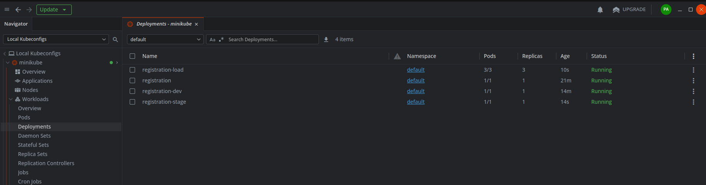
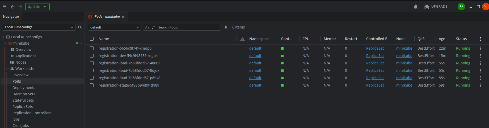
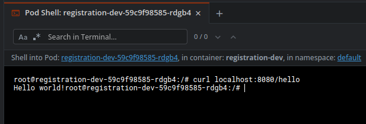
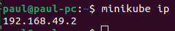
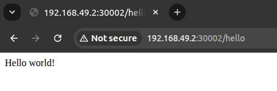

# hw-16: сервис регистрации в kubernetes через helm

приложение из дз по docker: spring boot сервис регистрации с эндпоинтом GET /hello,
возвращает "Hello world!". деплою его в локальный кластер minikube через helm chart -
шаблоны deployment и service, параметры в values.yaml. снаружи сервис торчит через
nodeport.

## как запустить

сборка jar и образа:

    cd homeworks/hw-16-helm
    mvn package
    docker build -t hw-16-helm:1.0 .

поднимаю кластер:

    minikube start --driver=docker --cpus=2 --memory=4g

переношу собранный образ внутрь кластера:

    minikube image load hw-16-helm:1.0

## шаблонизация: один chart - четыре приложения

деплой под именем релиза registration, базовые значения лежат в [values.yaml](chart/values.yaml):

    helm install registration ./chart

в envs/ лежат три конфига с переопределенными значениями:

    dev.yaml    - appname registration-dev, nodePort 30002
    stage.yaml  - appname registration-stage, nodePort 30003
    load.yaml   - appname registration-load, nodePort 30004 (3 реплики)

при установке с флагом -f helm объединяет env-файл с values.yaml:
совпавшие ключи берутся из env-файла, остальные - из values.yaml:

    helm install registration-dev ./chart -f envs/dev.yaml
    helm install registration-stage ./chart -f envs/stage.yaml
    helm install registration-load ./chart -f envs/load.yaml

итог - четыре релиза одного chart, все отвечают:

    curl http://$(minikube ip):30001/hello
    curl http://$(minikube ip):30002/hello
    curl http://$(minikube ip):30003/hello
    curl http://$(minikube ip):30004/hello
    Hello world!

узел кластера отвечает по своему адресу, а не по localhost.

у registration-load три реплики, у остальных по одной.

## скрины

проверяю состояние кластера через приложение Lens. вижу 4 деплоймента:  

у registration-load три реплики, всего шесть подов:  

в Lens запустил терминал внутри пода и вызвал /hello на локалхосте:  

решил выполнить /hello вне кластера. сначала узнал адрес узла:  

затем обратился к внешнему порту 30002 сервиса registration-dev:  

