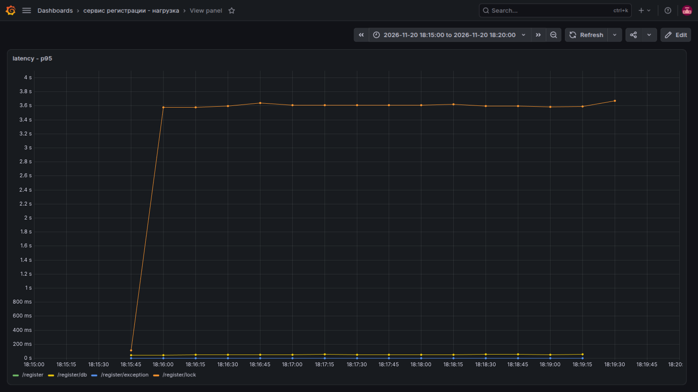
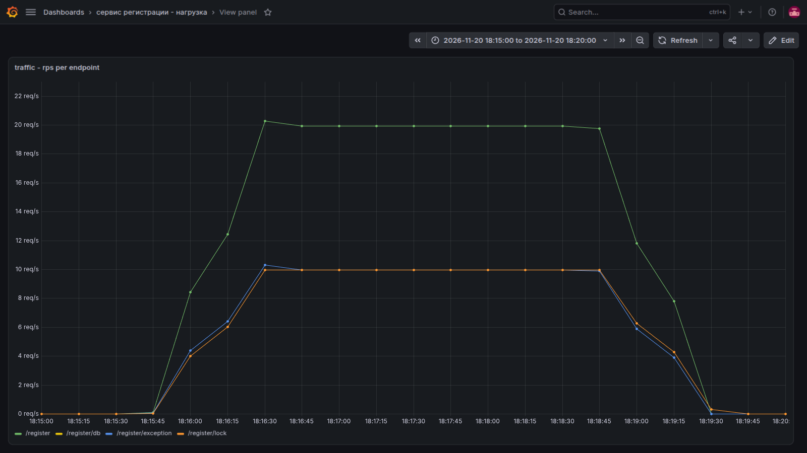
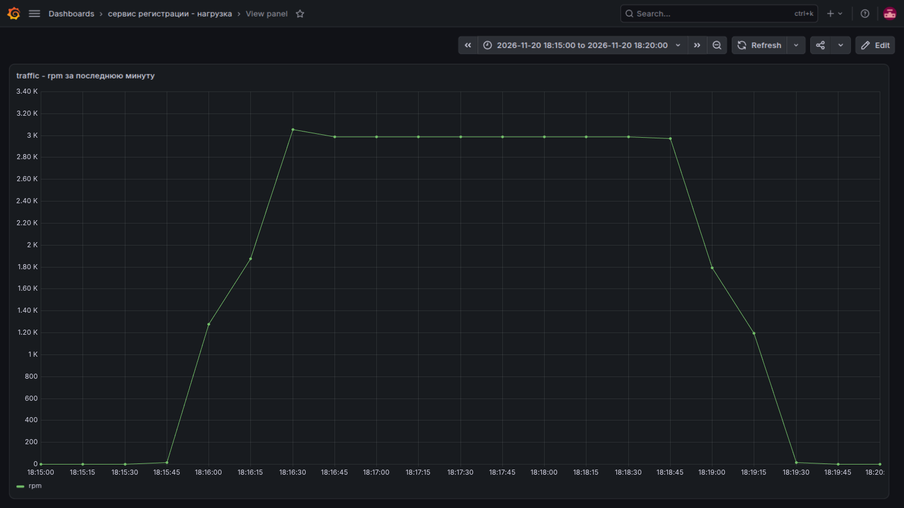
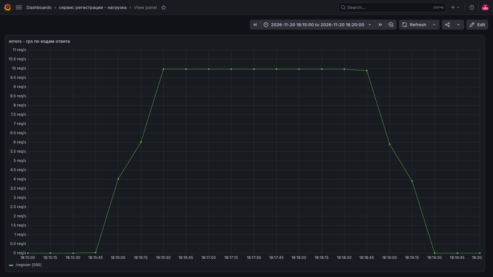
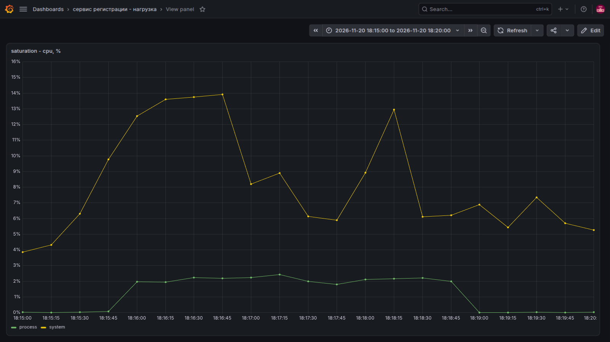
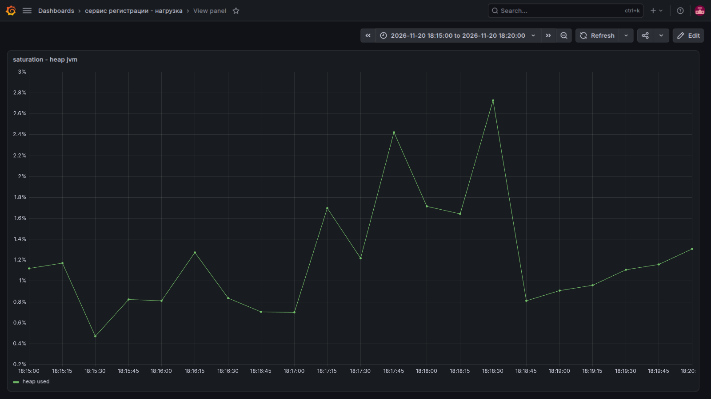

# Метрики сервиса регистрации в prometheus и grafana

Сервис регистрации из прошлых дз: четыре endpoint'а - POST /register,
/register/db, /register/exception, /register/lock. к сервису подключил actuator
с micrometer-registry-prometheus, prometheus забирает метрики каждые 10
секунд. нагрузку гоню через JMeter.

## Как снимал

```
mvn package
java -jar target/hw-17-prometheus-1.0-SNAPSHOT.jar --server.port=8081
docker run -d --network host \
  -v ./prometheus.yml:/etc/prometheus/prometheus.yml prom/prometheus:v3.15.1
docker run -d --network host grafana/grafana:13.2.4
~/tools/apache-jmeter-5.6.3/bin/jmeter -n -t user-registration.jmx
```

в grafana добавил datasource prometheus и собрал дашборд.

нагрузка шла 3 минуты, 2026-11-20 с 18:15:36 по 18:18:38. все скрины сняты
за 18:15 - 18:20.

## latency

95-й процентиль по каждому endpoint-у:
histogram_quantile(0.95, sum by (le, uri) (rate(http_server_requests_seconds_bucket{uri!~"/actuator.*"}[1m])))



- /register/lock - p95 около 3.6 с: запросы стоят в очереди на замок
- остальные - миллисекунды

## traffic

rps по каждому endpoint-у: sum by (uri) (rate(http_server_requests_seconds_count{uri!~"/actuator.*"}[1m]))



- /register 20 rps: в плане jmeter он идёт дважды. остальные три по 10 rps

---

rpm за последнюю минуту: sum(increase(http_server_requests_seconds_count{uri!~"/actuator.*"}[1m]))



## errors

rps ошибочных ответов по endpoint-у и коду: sum by (uri, status) (rate(http_server_requests_seconds_count{status!~"2..|3.."}[1m]))



- все ошибки от /register: jmeter каждый пятый запрос шлёт с ошибкой

## saturation

cpu процесса и системы, %: 100 * process_cpu_usage и 100 * system_cpu_usage



- под нагрузкой процесс около 2%, система до 15%

---

heap jvm, %: 100 * sum(jvm_memory_used_bytes{area="heap"}) / sum(jvm_memory_max_bytes{area="heap"})


