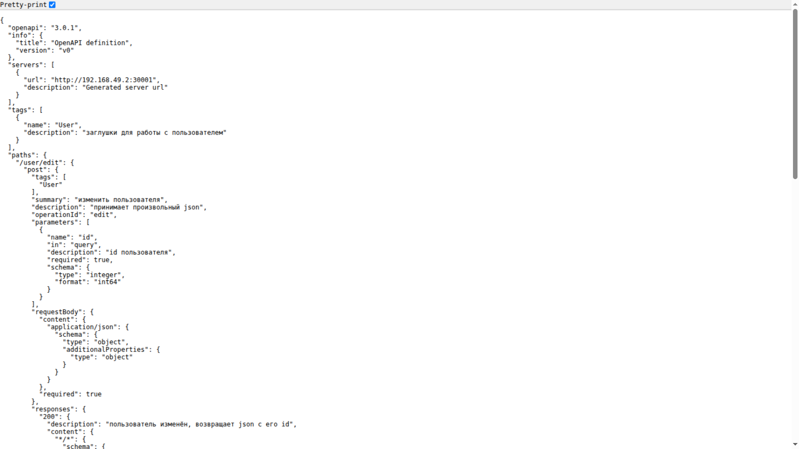
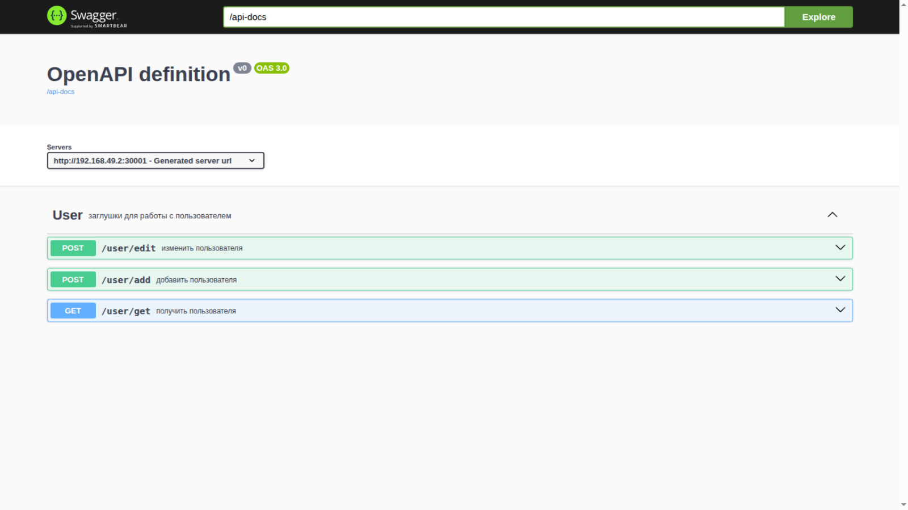
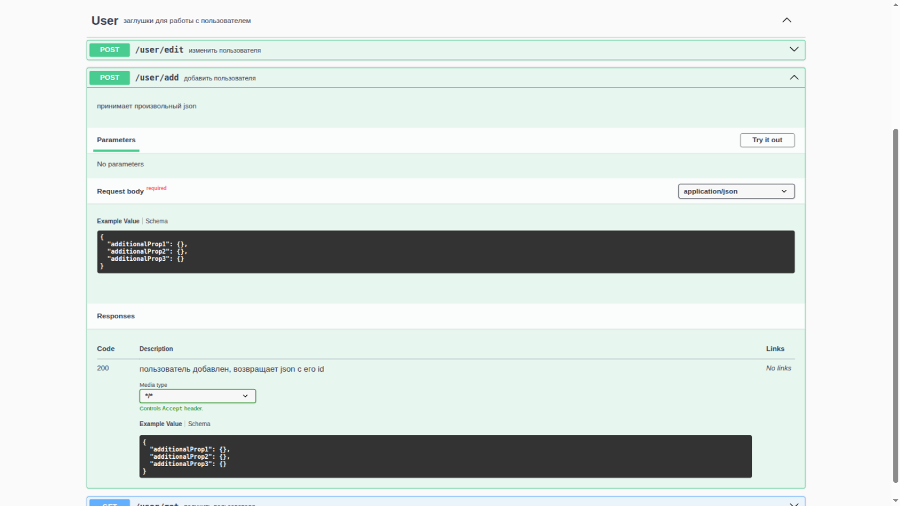
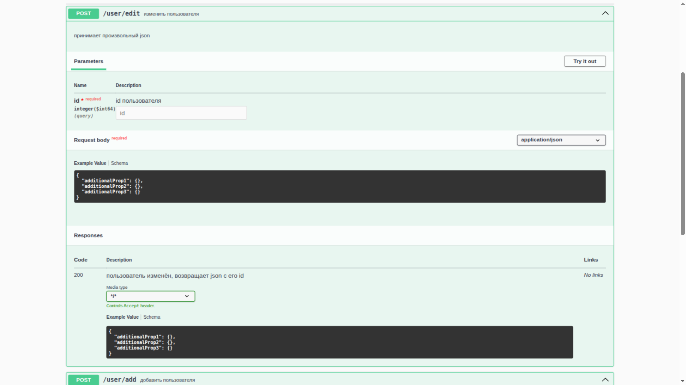
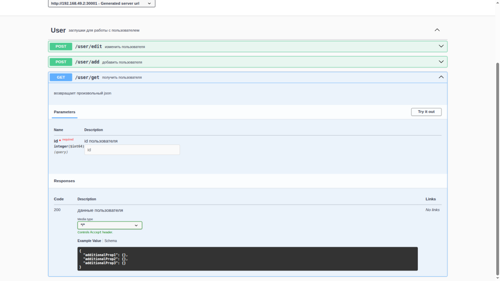
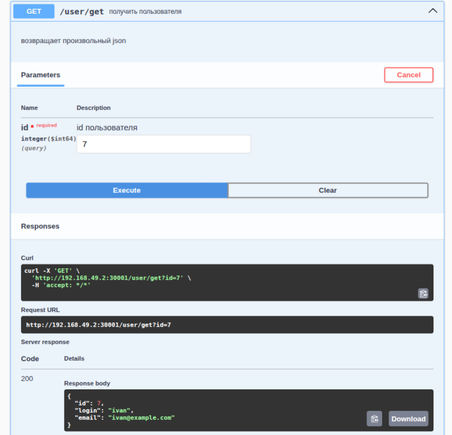

# Описание rest-сервиса с помощью openapi

Сервис регистрации из прошлых дз. к нему подключил springdoc и добавил три
эндпоинта-заглушки - POST /user/add, POST /user/edit и GET /user/get. описание
сделано аннотациями в контроллере UserController. документ openapi отдаётся по
/api-docs, swagger ui - по /api-docs-ui. сервис развёрнут в локальном кластере
minikube через helm chart из дз по helm.

## Как снимал

```
cd homeworks/hw-18-openapi
mvn package
docker build -t hw-18-openapi:1.0 .
minikube start
minikube image load hw-18-openapi:1.0
helm install registration ./chart
```

адрес узла кластера - 192.168.49.2, из команды minikube ip. сервис открыт на
порту 30001.

## документ openapi

http://192.168.49.2:30001/api-docs



## swagger ui

http://192.168.49.2:30001/api-docs-ui



## эндпоинты

POST /user/add:



---

POST /user/edit?id=:



---

GET /user/get?id=:



## вызов из кластера

в swagger ui раскрыл GET /user/get, нажал try it out, в поле id ввёл 7
и нажал execute. ответ: код 200, в теле `{"id": 7, "login": "ivan", "email": "ivan@example.com"}`


