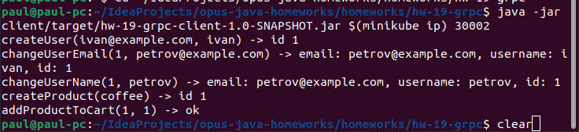

# gRPC сервис

gRPC сервис магазина. сущности user и product и сервис shop с пятью методами
описаны в proto-файле server/src/main/proto/shop.proto. данные хранятся в памяти. сервис развёрнут в локальном кластере minikube через helm chart

## Как снимал

все команды из папки hw-19-grpc

запуск сервиса:

```
mvn package
docker build -t hw-19-grpc:1.0 .
minikube start
minikube image load hw-19-grpc:1.0
helm install shop ./chart
```

сервис работает в кластере, в поде. адрес узла - из команды minikube ip, сервис
открыт на порту 30002. серверу нужно время, чтобы подняться, поэтому клиента
запускаю не сразу.

вызов клиента:

```
java -jar client/target/hw-19-grpc-client-1.0-SNAPSHOT.jar $(minikube ip) 30002
```

клиент запускается на машине, вне кластера, и подключается к сервису по адресу
узла. адрес узла подставляет команда minikube ip, адрес и порт клиент принимает аргументами.

## вызов через кластер


