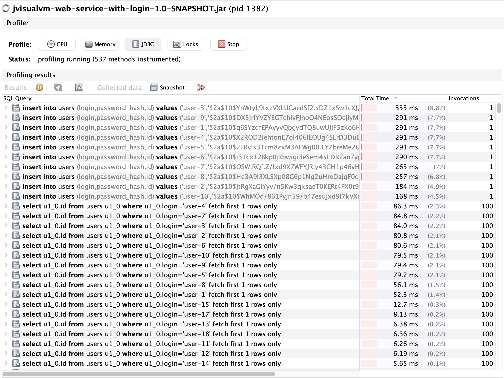

# Профилирование с помощью visualvm

## Цель

Реализовать тестовый пример, содержащий проблемы, которые потом продемонстрировать в visualvm

## Ход работы

Обычная регистрация сохраняет пользователя одним вызовом `UserRepository.save`.
Spring-профиль `extra-queries` (было реализовано в дз по JFR) дополнительно вызывает `UserRepository.existsByLogin` 100 раз

### Запуск сервиса с `extra-queries` профилем

```bash
java -jar jvisualvm/target/jvisualvm-web-service-with-login-1.0-SNAPSHOT.jar \
  --spring.profiles.active=extra-queries \
  --server.port=18083
```

В журнале должно появиться сообщение:

```text
Intentional profiling problem enabled: 100 redundant database queries per registration
```

### Запуск нагрузки JMeter

```bash
jmeter -n \
  -t jvisualvm/jmeter/registration-load.jmx \
  -Jhost=localhost \
  -Jport=18083 \
  -Jthreads=10 \
  -Jduration=120 \
  -Jrps=10 \
  -JresultPath="$(pwd)/jvisualvm/results/extra-queries.jtl" \
  -j "$(pwd)/jvisualvm/results/extra-queries-jmeter.log"
```

### VisualVM



### Flame graph async-profiler

[Открыть flame graph](profiling/flamegraph.html).

## Анализ

### JDBC profiling (VisualVM)

- В профиле зафиксировано `1107` вызовов `INSERT` и `110700` вызовов `SELECT`.
  На каждый полезный `INSERT` приходится ровно 100 одинаковых проверок существования
  логина.
- Одна регистрация выполняет 101 SQL-запрос вместо одного. Таким образом, 100 из 101,
  или примерно `99%`, обращений к БД не влияют на результат операции.
- Несмотря на малое среднее время одного `SELECT` в H2 (`0.013` мс), их суммарное
  время составило около `1.48` с.

Следовательно, проблема заключается не в одном медленном запросе, а в стократном
увеличении количества обращений к БД.

### async-profiler

- `BCrypt.crypt_raw` занимает ~`52.24%` CPU. Это ожидаемая стоимость хеширования пароля.
- Ветка `RedundantQuerySimulator.executeRedundantDatabaseQueries -> existsByLogin` занимает около `2.52%` всех CPU-сэмплов.
- Необходимый `SimpleJpaRepository.save` занимает около `0.68%`.

Следовательно, заведомо бесполезная ветка чтения потребляет примерно в 3.7 раза больше CPU, чем единственная полезная операция сохранения.
